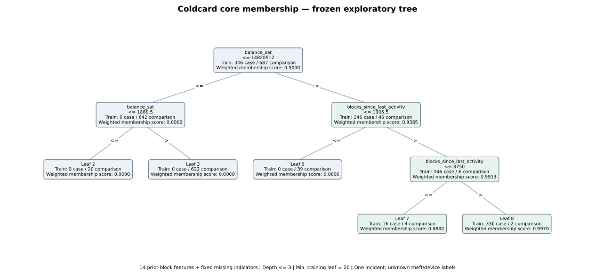

# Frozen source-membership baseline — 2 November 2026

One prespecified shallow decision tree was fitted on training addresses only. Target: `known_coldcard_core_membership`. The unit is one unique selected input source address. This is retrospective within-window development on previously inspected case profiles; all 500 cases belong to one incident. Independently verified compromise/device labels remain unknown.

## Frozen inputs and preparation

The latest schema-v2 view supplies 1,378 vectors (500 cases, 878 comparisons) from 1,500 fixed selections. The 122 bounded-incomplete comparison prefixes retain null vectors and no scores. Their much larger saved full-current-history counters establish an important coverage limitation; no unavailable prior-block vector was imputed. Full-history comparison statuses stay 864 complete / 136 incomplete, separate from prefix coverage.

The 918 audited components and the original SHA256 salt/buckets are unchanged. Shared prior references, reference TXIDs and full vectors do not cross partitions in the observed completed evidence. Unknown links of excluded histories are not claimed absent. The entire reference block and future are excluded from the fourteen predictors.

| Partition | Cases | Comparisons | Components |
| --- | ---: | ---: | ---: |
| train | 346 | 687 | 633 |
| validation | 56 | 55 | 99 |
| test | 98 | 136 | 186 |

Depth 3, minimum 20 training rows per leaf, balanced training class weights, seed 42; all other parameters are pinned in `protocol.json`. One training fit, no parameter search, rerolled groups, threshold selection or refit on validation/test. The membership threshold is **score >= 0.5**, including equality.

Each original column uses its training median; zero is a fallback only if that entire training column is missing. Fourteen fixed missingness indicators accompany the fourteen unchanged predictors. The inactivity and balance ranking comparators use the same training-only median fills. No identifiers, block metadata, collection counters, reference-payment fields or evidence labels enter the model.

## Metrics

| Partition | Method | Membership AP | Membership ROC-AUC | Membership precision | Membership recall | Membership F1 |
| --- | --- | ---: | ---: | ---: | ---: | ---: |
| train | tree | 0.993466 | 0.998342 | 0.982955 | 1.000000 | 0.991404 |
| train | constant_train_prevalence | 0.334947 | 0.500000 | — | — | — |
| train | inactivity_rank | 0.947170 | 0.981708 | — | — | — |
| train | balance_rank | 0.856466 | 0.963284 | — | — | — |
| validation | tree | 0.981534 | 0.990422 | 0.982456 | 1.000000 | 0.991150 |
| validation | constant_train_prevalence | 0.504505 | 0.500000 | — | — | — |
| validation | inactivity_rank | 0.964511 | 0.967532 | — | — | — |
| validation | balance_rank | 0.905555 | 0.955195 | — | — | — |
| test | tree | 0.993757 | 0.994748 | 0.989796 | 0.989796 | 0.989796 |
| test | constant_train_prevalence | 0.418803 | 0.500000 | — | — | — |
| test | inactivity_rank | 0.982880 | 0.986645 | — | — | — |
| test | balance_rank | 0.765014 | 0.911877 | — | — | — |

Train metrics are resubstitution diagnostics. Validation and test are fixed development partitions from the same previously inspected incident/window. Every AP and ROC-AUC was independently recomputed from tied score groups and pair counts. Constant/univariate methods have ranking metrics only. Scores are class-balanced leaf proportions, not calibrated theft/device probabilities. The sampled prevalences differ from blockchain prevalence.

| Partition | True positive membership | False positive membership | False negative membership | True negative membership |
| --- | ---: | ---: | ---: | ---: |
| train | 346 | 6 | 0 | 681 |
| validation | 56 | 1 | 0 | 54 |
| test | 97 | 1 | 1 | 135 |

## Rules, support and missingness



Node supports in the diagram are raw training-address counts. Scores use training class weights. Exact float32-routing thresholds, node supports by partition and leaf conditions are saved in `model.json`, `summary.json` and `rules.json`.

| Leaf | Conditions (all required) | Score | Train case/comparison | Validation case/comparison | Test case/comparison |
| --- | --- | ---: | ---: | ---: | ---: |
| 2 | balance_sat <= 14820511.5; balance_sat <= 1889.5 | 0.000000 | 0/20 | 0/2 | 0/25 |
| 3 | balance_sat <= 14820511.5; balance_sat > 1889.5 | 0.000000 | 0/622 | 0/47 | 0/93 |
| 5 | balance_sat > 14820511.5; blocks_since_last_activity <= 1006.5 | 0.000000 | 0/39 | 0/5 | 1/17 |
| 7 | balance_sat > 14820511.5; blocks_since_last_activity > 1006.5; blocks_since_last_activity <= 8750 | 0.888171 | 16/4 | 3/0 | 3/1 |
| 8 | balance_sat > 14820511.5; blocks_since_last_activity > 1006.5; blocks_since_last_activity > 8750 | 0.996957 | 330/2 | 53/1 | 94/0 |

Used input columns: balance_sat, blocks_since_last_activity. Used explicit missing indicators: none.

No explicit indicator split does not imply independence from missingness: a numeric split can route a median-imputed value. `node_support` records how many addresses use an imputed value at each numeric split; per-feature missingness by partition is also saved. Undefined fees remain distinct from unavailable vectors. No ablation or additional model was fitted.

`predictions.json.gz` records all 1,378 eligible source IDs, components, partitions, scores, comparator ranks and missing columns. `errors.json.gz` lists each membership error with the original fourteen features; comparisons are not relabeled as legitimate or compromised. `split_manifest.json.gz` retains all 1,500 selections, including the 122 exclusions.

## Interpretation and next unit

Interpret performance only as retrospective separation of this selected, covered case-membership cohort. Strong separation can reflect incident-specific age, balance or usage profiles; it does not prove compromise, hardware identity, causation or transfer to another incident. There are zero independently verified compromise/device labels. The one owner report remains separate evidence. Coverage excludes 12.2% of selected comparisons, disproportionately large histories. The frozen external nineteen-feature forest and all older results are unchanged. No network collection or automation was started.

The next aligned unit is a bounded review of the saved rules, membership errors and evidence limitations for the research report. Do not tune on these validation/test outcomes or present them as a new independent test; a new independent evaluation needs its own evidence and protocol.

## Reproduction

Python/scikit-learn/NumPy/SciPy/Matplotlib versions and SHA256 inputs are pinned. The model is inert JSON; verification performs no fitting and replays every score with float32 input conversion, training-only preprocessing, class weights, node counts, ranking metrics and output fingerprints.

From `Task 2/research/coldcard`:

```sh
python train_source_membership.py verify source_membership_baseline_20261102_162335/protocol.json
python -m unittest test_source_membership test_source_comparison_feasibility test_prepayment_pilot
```

Method references: [scikit-learn 1.8 tree](https://scikit-learn.org/1.8/modules/generated/sklearn.tree.DecisionTreeClassifier.html), [training-only preparation](https://scikit-learn.org/1.8/common_pitfalls.html), [average precision](https://scikit-learn.org/1.8/modules/generated/sklearn.metrics.average_precision_score.html). Reviewed 2 November 2026. Parameter choices and cutoff/group rules come from the already frozen project protocol.
